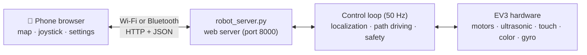
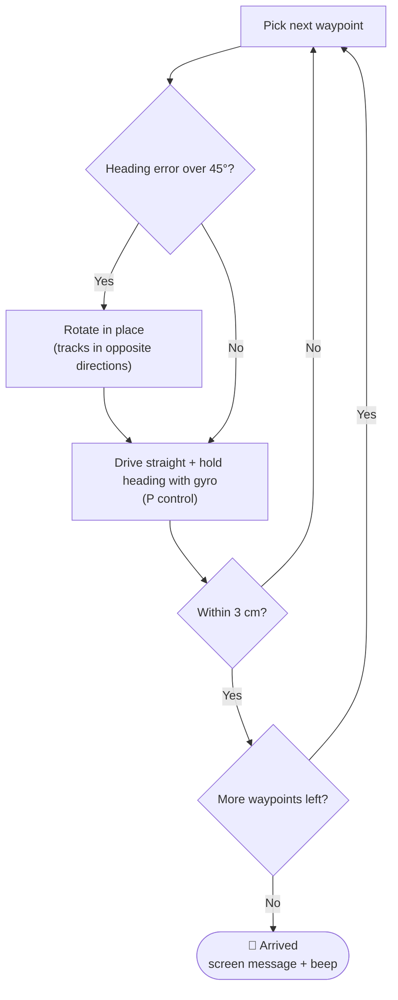

<div align="center">

# 📱 EV3 Smartphone Remote

**A Python guide robot that finds its own way to a classroom when you tap it on the map**

Pick a room, drive with a joystick, and adjust speed, all from a phone browser


</div>

---

## 📑 Table of Contents

- [Project Overview](#-project-overview)
- [What Changed from the EV3 Classroom Version](#-what-changed-from-the-ev3-classroom-version)
- [Features](#-features)
- [Hardware Setup](#-hardware-setup)
- [What You Need](#-what-you-need)
- [Installation](#-installation)
- [First Run](#-first-run)
- [How It Works](#-how-it-works)
- [Settings](#-settings)
- [API](#-api)
- [Troubleshooting](#-troubleshooting)
- [Repository Structure](#-repository-structure)

---

## 📌 Project Overview

This project is a **Python rewrite** of the classroom guide robot we first built with **EV3 Classroom (block coding)**. It was written with the help of AI (Claude).

The robot runs a small **web server**, and the phone controls it by opening that address in an ordinary browser. There is nothing to install on the phone.



The page has three tabs.

| Tab | What it does |
| --- | --- |
| **Classrooms** | Shows the robot's current position and the classrooms on your hand-drawn map. Tap a classroom on the map, or a room-number button, and the robot **finds a path from where it is, along the corridors**, and drives there. |
| **Joystick** | Drive the robot by hand with your finger. Its position on the map keeps updating while you drive. |
| **Settings** | Upload the map image, calibrate distance, and change behavior settings. |

The **speed slider** and the red **Stop button** are visible on every tab.


## 🔄 What Changed from the EV3 Classroom Version

| | EV3 Classroom version | Python version (this repo) |
| --- | --- | --- |
| Routes | Hard-coded per room in the program (`FOLLOW` · `LEFT` · `RIGHT` · `DRIVE`) | Shortest path computed automatically from the **corridor lines** on the map |
| Choosing a room | Buttons on the EV3 brick | Tap the map or a room button on the phone |
| Localization | Runs the next command when it meets a yellow sticker | **Continuously estimates position** from motor rotation + gyro, corrected by yellow stickers |
| Manual control | None | Joystick |
| Adding a room | Edit the block code | Tap on the map |
| Runs on | EV3 Classroom app (stock firmware) | ev3dev (microSD card) |

The safety features of the original version (obstacle stop, touch-sensor emergency stop, use of yellow stickers) were carried over.


## ✨ Features

- 📍 **Map-based path finding**: connect corridor points and lines on the map, and the robot computes the shortest route
- 🎮 **Joystick driving**: the robot stops by itself if the connection drops for more than 0.6 s
- 🧭 **Position estimation**: distance from motor rotation and heading from the gyro give the robot's position on the map
- 🟡 **Sticker correction**: passing a yellow sticker removes accumulated position error
- 🚧 **Obstacle waiting**: stops when something is within 15 cm and continues once it is gone
- 🛑 **Touch sensor**: when pressed, the robot stops and turns 180° (can be changed to "stop only" in Settings)
- 🧪 **Simulator**: test the phone page on a computer without the robot
- 💾 **Auto-save**: settings go to `settings.json`, the map goes to `map.json`


## 🔌 Hardware Setup

Same layout as the EV3 Classroom project.

| Port | Connected to | Role |
| :---: | --- | --- |
| B, D | Motors (tracks) | Driving |
| 1 | Ultrasonic sensor | Waits when an obstacle is within 15 cm |
| 2 | Touch sensor | Stop, then turn 180° |
| 3 | Color sensor (facing the floor) | Corrects the map position using yellow stickers |
| 4 | Gyro sensor | Robot heading (turns are inaccurate without it) |

> Physically, B is the right motor and D is the left, and both are mounted flipped, so the default setting is `invert_motors: true`.

## 🧰 What You Need

1. **A microSD card with ev3dev**
   - The stock LEGO firmware cannot run the Python server.
   - Download the *ev3dev-stretch* image from ev3dev.org, write it to the card with Etcher, and put the card into the EV3.
   - Take the card out and the EV3 goes back to working with EV3 Classroom as before.
   - If you already have a "LEGO EV3 MicroPython" card, it is also based on ev3dev and can be used.
2. **A connection to the phone** (one of the two)
   - **USB Wi-Fi adapter** (recommended): plug in an adapter from the compatibility list on ev3dev.org and connect the EV3 to your phone's hotspot. (EV3 menu: *Wireless and Networks → Wi-Fi*)
   - **Bluetooth**: turn on Bluetooth tethering on the phone, then connect from the EV3 with *Wireless and Networks → Bluetooth → Network Connection*.

## 📦 Installation

1. Put `robot_server.py` and the `static` folder (containing `index.html`) into a folder named `ev3robot` and copy it to the EV3.
   - The easiest way is the *ev3dev-browser* extension for VS Code.
   - Over the network: `scp -r ev3robot robot@ev3dev.local:~/` (password `maker`)
2. On the EV3, open *File Browser → ev3robot → robot_server.py* and press the center button.
   - If it does not run, execute `chmod +x ~/ev3robot/robot_server.py` once on the EV3.
3. **Do not touch the robot for the first 2 seconds.** That is when the gyro is calibrated.
4. When an address such as `Phone: http://192.168.43.57:8000` appears on the EV3 screen, open it in your phone's browser.

**To test without the robot**, run the command below on a computer and open `http://localhost:8000`. In this mode a virtual robot moves.

```bash
python3 robot_server.py --sim
```

To change the port, pass it like `--port 9000`.

## 🚀 First Run

Follow these in order.

> The web page is currently in Korean. Button and tab names below are translated.

1. **Distance calibration** (*Settings*)
   Press "Drive 3 rotations", measure the real distance traveled with a tape measure, enter it, and save. If you skip this step, travel distances will be wrong.
2. **Check the direction** (*Joystick*)
   Pushing forward must move the robot forward, and the arrow on the map must turn the same way as the robot.
   - If the robot goes backward, see [Troubleshooting](#-troubleshooting).
   - If only the arrow turns the wrong way, choose *Settings → Gyro → Reverse*.
3. **Upload the map** (*Settings*)
   Photograph your hand-drawn map **from directly above**, upload it, enter the map's **real width in cm**, and press "Save map".
4. **Edit the map** (*Classrooms* tab → "Edit map", only needed once)
   - **Corridors**: tap points along the center of the corridors. Each new point is joined to the previous one by a line. To make a junction, tap an existing point and continue from there; "Start new line" begins a separate line. The robot only drives **on these lines**, so draw them where there are no walls.
   - **Classrooms**: tap the spot in front of a classroom door and enter its number (301, 302, 303, ...). Tap it again to rename it.
   - **Stickers**: mark every yellow sticker on the floor. When the robot passes one, it corrects its own position.
   - **Delete**: tap a classroom, corridor point, or sticker to delete it.
   - Press "Done" when finished.
5. **Set the robot's position**
   Press "Set robot position", then on the map press where the robot is and drag your finger in the direction the robot is facing. Do this every time you power on, if the robot is not where it last stopped.
6. **Go**
   Tap a classroom on the map and confirm "Go", or press a room-number button below the map. If you select another classroom while the robot is moving, it turns toward the new destination from its current position.

## 🧠 How It Works

### Position estimation (odometry)

- Motor rotation tells the robot **how far it has gone**, and the gyro tells it **which way it is facing**. Together they update the map coordinates `(x, y)` and heading.
- Small errors build up over time, so when the robot detects a **yellow sticker 3 times in a row**, it corrects its position to the nearest sticker marked on the map (within 40 cm).
- Without a gyro, heading is estimated from the difference between the two tracks' rotation. (Turns are less accurate in this case.)

### Path finding

1. The robot first moves to the nearest point on a corridor line.
2. It computes the **shortest path** between corridor points (Floyd–Warshall algorithm, suited to small maps).
3. It leaves the corridor line closest to the destination and goes to the front of the classroom door.
4. If the corridor points are not connected to each other, it returns the error "points are not connected".

### Path driving



- When the last point is within 15 cm, the robot slows down to stop smoothly.
- The control loop runs at **50 Hz (every 0.02 s)**, handling sensor reads, position update, and drive commands in one pass.

### Safety

| Situation | Behavior |
| --- | --- |
| Obstacle within 15 cm (path driving) | Stops and waits; continues once it is 18 cm or more away for 0.5 s |
| Obstacle within 15 cm (joystick) | Blocks only forward input; reversing and turning still work |
| Touch sensor | Stops, then turns 180° (or just stops) |
| No joystick signal for 0.6 s or more | Stops automatically |
| Error in the control loop | Stops the motors and returns to standby |

> The stop distance (15 cm) and the restart distance (18 cm) are different on purpose, which prevents the robot from jittering between stopping and starting at the boundary.

## 🔧 Settings

You can change these in the *Settings* tab, and they are saved to `settings.json`. (`settings.json` is created after the first save, and you can also open and edit it directly on the EV3 with VS Code.)

| Setting | Default | Description |
| --- | :---: | --- |
| `speed` | 40 | Speed for path driving and joystick (%) |
| `turn_speed` | 25 | Speed for turning in place (%) |
| `heading_kp` | 1.5 | How strongly the robot steers back onto the path |
| `cm_per_rot` | 12.0 | Distance traveled per motor rotation (cm), needs calibration |
| `track_width_cm` | 12.0 | Distance between the tracks (used only without a gyro) |
| `sensor_offset_cm` | 8.0 | Distance from the turning center forward to the color sensor |
| `obstacle_cm` / `clear_cm` | 15 / 18 | Obstacle stop and restart distances |
| `snap_radius_cm` | 40 | Stickers within this radius are used to correct position |
| `touch_action` | `turn180` | `turn180` or `stop` |
| `gyro_sign` | 1 | Set to `-1` if the turn direction on the map is reversed |
| `invert_motors` | `true` | Use when the motor's "forward" is physically backward |
| `left_port` / `right_port` | `D` / `B` | Left and right motor ports |

> After changing the ports or `invert_motors`, restart the program for the change to take effect.

## 🌐 API

This is the HTTP API used by the phone page. You can also call it directly to build another client.

| Method | Path | Description |
| :---: | --- | --- |
| GET | `/api/state` | Position, heading, mode, path, sensor values |
| GET | `/api/map` · `/api/settings` | Read the map and settings |
| POST | `/api/joystick` | Joystick values `{x, y}` |
| POST | `/api/goto` | Go to a room `{room}` |
| POST | `/api/path` | Follow custom waypoints `{points, append}` |
| POST | `/api/stop` | Stop |
| POST | `/api/speed` | Change speed `{speed}` |
| POST | `/api/pose` | Set the robot's position `{x, y, heading}` |
| POST | `/api/turn` | Rotate in place `{degrees}` |
| POST | `/api/testdrive` | Test drive for distance calibration `{rotations}` |
| POST | `/api/map` · `/api/settings` | Save the map and settings |
| POST | `/api/sim_obstacle` | Create a virtual obstacle (simulator only) |

## 🩺 Troubleshooting

| Symptom | Fix |
| --- | --- |
| The robot goes backward | Flip the `"invert_motors"` value in `settings.json` and restart the program |
| Joystick "right" turns left | In `settings.json`, swap `"left_port": "D"` and `"right_port": "B"`, then restart |
| The arrow on the map turns the wrong way | *Settings → Gyro → Reverse* |
| The robot goes farther or shorter than it should | Run the distance calibration again |
| "Corridor points are not connected" | In *Edit map → Corridors*, tap a point on one line and then a point on another line to join them into one network |
| The robot cuts through walls | Add corridor points at the corners so the lines follow the hallway |
| Turns are inaccurate | Check that the gyro is on port 4 and that the robot was standing still at startup |
| The page does not open | Check that the phone and the EV3 are on the same network and that the address on the EV3 screen is correct |
| Yellow stickers are not detected | Lower the color sensor to about 1 cm above the floor and use clear matte yellow stickers |

## 📁 Repository Structure

```text
ev3robot/
├── robot_server.py     # web server + control loop (localization, path finding, driving, safety)
├── static/
│   └── index.html      # phone control page (classrooms · joystick · settings)
├── settings.json       # saved settings (created automatically after the first save)
└── map.json            # map, classrooms, corridors, stickers (created automatically on save)
```

- `robot_server.py` uses only the standard library, plus `ev3dev2` on the EV3.
- On a computer without `ev3dev2`, it automatically runs as a simulator.

---

<div align="center">

**Made by**

👑 **Ayan Sailaubayev** ([@zvcwv](https://github.com/zvcwv)) – EV3 base code, ev3dev environment setup, GitHub <br>
**Sergey Um** ([@visyy](https://github.com/visyyy)) – Python code, robot logic, bug fixing <br>
**Minjun Kim** ([@beat-bit](https://github.com/beat-bit)) – Robot build, robot testing <br>
**Juha Kim** – Presentation, video recording

</div>
